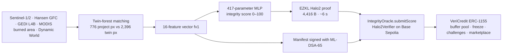
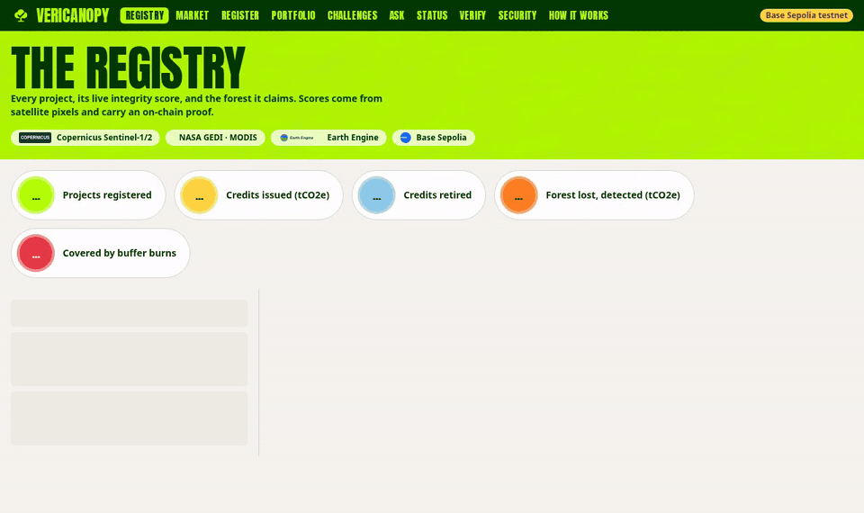

<p align="center">
  
</p>

<h1 align="center">VeriCanopy</h1>

<p align="center"><strong>Carbon credits that prove themselves.</strong><br/>
Satellite evidence → integrity score → zero-knowledge proof on-chain → a credit that keeps watching the forest.</p>

<p align="center">
  <a href="https://vericanopy.vercel.app"></a>
  <a href="https://vericanopy-api.onrender.com/api/v1/status"></a>
  <a href="https://sepolia.basescan.org/address/0xa3a203519f86DdeeCA51771F43ca0840e51387b6"></a>
  <a href="https://github.com/LSUDOKO/VeriCanopy/actions/workflows/ci.yml"></a>
  <a href="https://github.com/LSUDOKO/VeriCanopy/releases"></a>
  <a href="LICENSE"></a>
</p>

<p align="center">
  <a href="https://vericanopy.vercel.app">Live app</a> ·
  <a href="https://vericanopy-api.onrender.com/docs">API docs</a> ·
  <a href="docs/MCP.md">MCP server</a> ·
  <a href="docs/ARCHITECTURE.md">Architecture</a> ·
  <a href="docs/BENCHMARKS.md">Benchmarks</a> ·
  <a href="docs/LIMITATIONS.md">Limitations</a> ·
  <a href="docs/video/v2/STORYBOARD.md">Launch film</a>
</p>

<p align="center"></p>

---

## The problem

Forest carbon credits are verified once, by someone you have to trust, against a baseline the developer chose. Nobody re-derives that baseline from pixels, nothing re-scores the forest after issuance, and the ratings that exist come from private models you cannot check. Independent studies keep finding that most claimed reductions never happened.

**VeriCanopy closes three trust gaps with one system:**

| Gap | Question | Mechanism |
|---|---|---|
| **Computation** | Did the AI really run the registered model? | EZKL/Halo2 proof verified on-chain by `Halo2Verifier`; the score is decoded from the proof's public instances, never trusted from the oracle |
| **Input** | Was the right land and data used? Is this land sold twice? | Reproducible, ML-DSA-65-signed manifest (datasets, dates, geometry hash, code commit); staked challenge game; H3 cell exclusivity in `ProjectRegistry` |
| **Time** | Is the credit still true today? | Living integrity score per project, automatic buffer burns, project freeze on shortfall, holder notifications |

## How it works



1. **Evidence.** Every monitoring period the oracle pulls Sentinel-2 and Sentinel-1 composites, Hansen tree-cover loss, GEDI L4B biomass, MODIS burned area and Dynamic World for the project polygon *and* for a matched twin forest nearby. The twin is the counterfactual, not a spreadsheet.
2. **Score.** Sixteen features go into a small, audited neural network (417 parameters, MAE 0.0125 against the transparent expert rule, zero monotonicity violations). Tapajós scored 71.9 in 2023; after 8,080 t of detected loss it scores 3.9.
3. **Proof.** Inference runs inside a Halo2 circuit (EZKL 23.0.5). The deployed verifier checks the proof before the score is stored; a wrong proof reverts the transaction. The evidence manifest is signed with ML-DSA-65 (FIPS 204) and the key is registered on-chain.
4. **A living credit.** Credits carry the live score. Detected loss burns buffer credits first; a shortfall freezes the project, blocks transfers and notifies every holder. Anyone can challenge a score with a bond; two of three independent resolvers recompute it.

## What you can do today (Base Sepolia)

| | |
|---|---|
|  | **Registry** — every project on a map with its live integrity status, H3 cells, and the credits, reversals and buffer coverage behind it. |
|  | **Project page** — real Sentinel-2 before/after, the twin-forest chart with the fire year, integrity history, claim vs reality, proofs & signatures, ML-DSA-signed auditor report, FIRMS fire badge, 10 km leakage ring and a year slider over the satellite tiles. |
|  | **Market** — escrowed fixed-price listings with the integrity score on the price tag, a price guide by integrity band, and portfolio retire → printable certificate. Frozen projects cannot trade. |
|  | **Ask** — deterministic, model-faithful explanation of any score (per-feature attribution, data sources, proof and signature status). No language model in the loop. |
|  | **Status** — database, RPC head, indexer lag, Earth Engine, signer, keeper balance and all ten contracts, refreshed every 30 s. |

Also: **Register** wizard with live H3 overlap pre-check and decoded `OverlapDetected` reverts · **Challenges** with bonds and 2-of-3 resolver votes · **Verify** page that re-checks hash ↔ chain, key ↔ registry, signature and proof mode · **Alerts** feed as JSON and RSS · **Model registry** page that compares the on-chain model hash with the published ONNX artifact.

### For agents: MCP server

Any Model Context Protocol client can read the registry, explain a score, verify a manifest and prepare **unsigned** marketplace or retirement transactions (your wallet signs; the server holds no keys).

```sh
claude mcp add --transport http vericanopy https://vericanopy-api.onrender.com/mcp
```

Ten tools, two resources — see [`docs/MCP.md`](docs/MCP.md).

## Measured, not promised

Every number is produced by code in this repository (`scripts/write_benchmarks.py`, `forge test --gas-report`, `pytest`). Full table in [`docs/BENCHMARKS.md`](docs/BENCHMARKS.md).

| Metric | Value |
|---|---|
| Contract tests (incl. a real EZKL proof verified by the deployed `Halo2Verifier`, fuzz + invariants) | 55 |
| Backend tests (indexer idempotency, verify binding, market, feeds, MCP, reports) | 31 |
| Web smoke tests against production | 11 |
| Proof size / proving time (mean of 20) | 4,416 B / 6.02 s |
| `Halo2Verifier` deployed bytecode | 19,817 B (limit 24,576) |
| On-chain verify inside `submitScore` | ≈1.08 M gas |
| Model | 16-16-8-1 MLP, 417 params, MAE 0.0125, 0 monotonicity violations |
| ML-DSA-65 sign / verify (pure Python) | ≈118 ms / ≈19 ms |
| Satellite datasets via Earth Engine | 10 |

## Pilot areas and data provenance

Two kinds of results exist on purpose:

- **Live submissions on Base Sepolia** (`provider: earthengine` in the manifest): features extracted from real Hansen GFC 2025, Sentinel-1/2, GEDI L4B, MODIS burned-area and Dynamic World pixels for the pilot polygons, proven with EZKL and verified on-chain. The pilot polygons (Tapajós riverine block, Loreto Marañón floodplain, Manavgat pine forest) were drawn by us for monitoring; they are **not** issued carbon projects, so their real-data scores are low (Tapajós/2025 = 3.9, Manavgat/2021 = 0.2 with 1.2 MtCO2e of real 2021 loss). That is the system working as intended.
- The first three submissions (`provider: fixture`) were made before Earth Engine access existed and use deterministic labelled fixture samples; they remain on-chain, labelled as such.

## Deployed addresses

| Component | Where |
|---|---|
| Web app | https://vericanopy.vercel.app (Vercel) |
| API, indexer, workers, MCP | https://vericanopy-api.onrender.com (Render, Docker, `GET /api/v1/status`) |
| Database | Neon Postgres (Alembic-managed) |
| Contracts | Base Sepolia (84532), `contracts/deployments/84532.json` |

| Contract | Address |
|---|---|
| ProjectRegistry | [`0x40Fc737bc985f8f75689a4B4E95D625a1c701e4a`](https://sepolia.basescan.org/address/0x40Fc737bc985f8f75689a4B4E95D625a1c701e4a) |
| ModelRegistry | [`0x36691AdE60cEc5A02B32690B159AC92C4Ec5ac9d`](https://sepolia.basescan.org/address/0x36691AdE60cEc5A02B32690B159AC92C4Ec5ac9d) |
| PQKeyRegistry | [`0xd760B9004F5ACF3814Ea833E601a23b060B922c2`](https://sepolia.basescan.org/address/0xd760B9004F5ACF3814Ea833E601a23b060B922c2) |
| IntegrityOracle | [`0xa3a203519f86DdeeCA51771F43ca0840e51387b6`](https://sepolia.basescan.org/address/0xa3a203519f86DdeeCA51771F43ca0840e51387b6) |
| Halo2Verifier | [`0x333c45Cbbb7AB746244767c199551e69A4Fa4965`](https://sepolia.basescan.org/address/0x333c45Cbbb7AB746244767c199551e69A4Fa4965) |
| ChallengeManager | [`0x1AA138691E23a3d35FDfB09CA7ABf7065987a14d`](https://sepolia.basescan.org/address/0x1AA138691E23a3d35FDfB09CA7ABf7065987a14d) |
| VeriCredit (ERC-1155) | [`0x69DEfd5a594542D4d1e514d4CD9d8CE1a448cE3f`](https://sepolia.basescan.org/address/0x69DEfd5a594542D4d1e514d4CD9d8CE1a448cE3f) |
| BufferPool | [`0xa536e7C93c32179747d6eD83fA5138B2b7879700`](https://sepolia.basescan.org/address/0xa536e7C93c32179747d6eD83fA5138B2b7879700) |
| RetirementRegistry | [`0x1D042FddCA42542D51CA4c33aB55db1835b010a9`](https://sepolia.basescan.org/address/0x1D042FddCA42542D51CA4c33aB55db1835b010a9) |
| Marketplace | [`0x305a35aAf5347c98C02930d35854e9a9B1c2e481`](https://sepolia.basescan.org/address/0x305a35aAf5347c98C02930d35854e9a9B1c2e481) |

First zk-verified submissions: [#1](https://sepolia.basescan.org/tx/0xc4f70226e3e782ed347acdc48826fa73be081c44482da12d4ea1ac3876f53487), [#2](https://sepolia.basescan.org/tx/0xd94d61e5fbb9bdbf274bb6be88052d63141275a073e631b5f5e0f4e57b3f2028), [#3](https://sepolia.basescan.org/tx/0xa973096281ffd3681a0d02e2a7742a2a37d5cb422dd0cdf77beba13f4fbd1a52).

## Architecture

| Layer | Stack | Lives in |
|---|---|---|
| Contracts | Solidity 0.8.26, OpenZeppelin v5, Foundry; EZKL-generated `Halo2Verifier` | `contracts/` |
| AI pipeline | Python 3.11, Earth Engine, numpy, ONNX, EZKL 23.0.5, dilithium-py (ML-DSA-65) | `ai/` |
| Backend | FastAPI, SQLAlchemy + Alembic (Neon Postgres), web3.py indexer, oracle + finalizer workers, content-addressed blob store, webhooks, MCP (FastMCP) | `backend/` |
| Web | Next.js 16, wagmi/viem, RainbowKit, MapLibre, GSAP + Lenis | `web/` |
| Ops | Vercel, Render (Docker), Neon, GitHub Actions CI + release workflow, ghcr.io image | `.github/`, `render.yaml` |

Details: [`docs/ARCHITECTURE.md`](docs/ARCHITECTURE.md) · feeds, certificates and monitoring: [`docs/FEATURES.md`](docs/FEATURES.md) · runbook: [`docs/DEPLOYMENT.md`](docs/DEPLOYMENT.md).

## Quick start

```bash
# prerequisites: foundry, uv, node 22 + pnpm, python 3.11 (uv downloads it)
make setup          # venv + forge deps + pnpm install
make zk-setup       # EZKL circuit, keys, SRS, Solidity verifier (one-off, ~1 min + SRS download)
make chain          # terminal 1: anvil
make deploy         # terminal 2: Halo2Verifier + full stack → contracts/deployments/31337.json
make seed           # register the pilot areas (one overlapping parcel is rejected on purpose)
cd backend && ../.venv/bin/uvicorn app.main:app --reload &     # API + MCP on :8000
cd backend && ../.venv/bin/python -m app.indexer.run &         # indexer
cd backend && ../.venv/bin/python -m app.workers.scheduler &   # finalizer loop
cd web && pnpm dev                                             # http://localhost:3000
make submit P=1 Y=2025   # oracle: pipeline → proof → ML-DSA sign → submitScore
make e2e                 # the whole story on a local chain, every step asserted
make test                # forge test + pytest (ai, backend) + vitest/lint/build (web)
```

Copy `.env.example` to `.env`. With `EE_SERVICE_ACCOUNT_JSON` and `EE_PROJECT` the pipeline uses live Earth Engine data; without them it uses labelled fixture samples (see [`docs/LIMITATIONS.md`](docs/LIMITATIONS.md)).

## Honesty: what is and is not proven

| Claim | Covered by |
|---|---|
| The registered model was used, unmodified | zk proof (fixed params; verifier bound to the circuit) + `ModelRegistry` |
| The score follows from the committed features | zk proof (Poseidon commitment of the 16 features is a public instance) |
| The features came from the stated satellite data | **not** the zk proof → reproducible manifest + challenge game |
| The scoring rule is scientifically right | **not** cryptography → open methodology + governance |

| Element | Quantum-safe? |
|---|---|
| Manifest attestations and auditor reports (ML-DSA-65) | ✅ |
| Hash commitments (SHA-256 / keccak256) | ✅ with sufficient output size |
| Ethereum transaction signatures (ECDSA) | ❌ ecosystem dependency (PQ account abstraction) |
| zk proofs (Halo2 + KZG) | ❌ pairing-based (hash-based STARK proofs on the roadmap) |

## Repository

```
ai/          Earth Engine extraction, matching, fv1 features, MLP, EZKL circuit, ML-DSA-65
backend/     FastAPI API, indexer, oracle/finalizer workers, MCP server, Alembic migrations
contracts/   Foundry project, tests, deployment scripts, generated Halo2Verifier
web/         Next.js app
scripts/     deploy, seed, e2e, benchmarks, media
docs/        architecture, benchmarks, limitations, MCP, features, submission kit, launch film
brand/       logo and brand guide
```

Contributing: [`CONTRIBUTING.md`](CONTRIBUTING.md) · security: [`SECURITY.md`](SECURITY.md) · changes: [`CHANGELOG.md`](CHANGELOG.md).

## References

- Tropical forest carbon offsets deliver partial gains amid persistent over-crediting — https://pubmed.ncbi.nlm.nih.gov/41066561/
- Unobserved confounders cannot explain over-crediting in avoided deforestation carbon projects — https://pmc.ncbi.nlm.nih.gov/articles/PMC13253331/
- Dynamic ex-post baselines for enhancing the credibility of IFM carbon offsets — https://pubmed.ncbi.nlm.nih.gov/41728826/
- Forest carbon protocols underestimate climate-driven carbon loss risks — https://pubmed.ncbi.nlm.nih.gov/42162435/
- Widespread increases in future wildfire risk to global forest carbon offset projects revealed by explainable AI — https://arxiv.org/abs/2305.02397
- Global, robust and comparable digital carbon assets (PACT) — https://arxiv.org/abs/2403.14581

## Data attributions

Hansen/UMD Global Forest Change, ESA Copernicus Sentinel-1/2, NASA GEDI L4B, NASA FIRMS and MODIS MCD64A1, SRTM, ESA WorldCover, Google Dynamic World (via Earth Engine). Basemap © OpenStreetMap contributors.

## Licence

MIT — see [`LICENSE`](LICENSE). Built for the IEEE ClimateChain Global Hackathon 2026, Carbon Markets & Emissions Transparency track. Testnet only; nothing here assesses any real carbon project.
