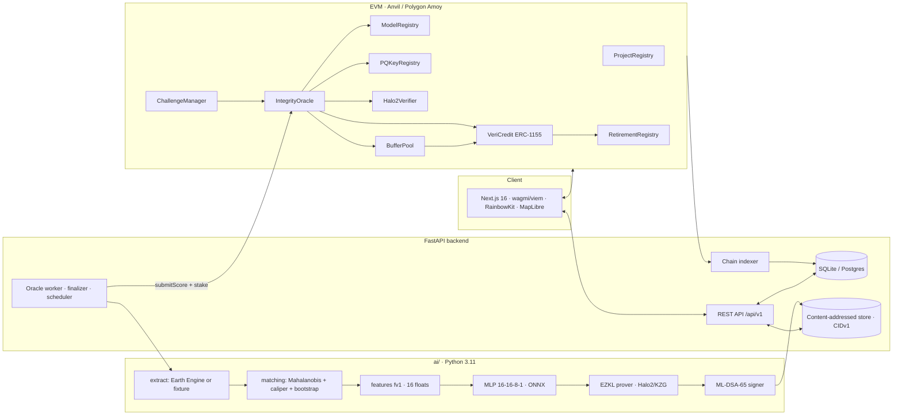

# Architecture



## Scoring lifecycle
1. **Extract** pixel samples inside the project and in a 10–50 km ring (`ai/vericanopy_ai/extract.py`). Live Earth Engine when credentials exist, otherwise deterministic fixture samples (labelled).
2. **Match** treatment pixels to control twins (propensity caliper + Mahalanobis NN), compute balance (SMD) and a bootstrap CI (`matching.py`).
3. **Measure** loss rates, support ratio, reversal tCO2e, leakage, fire fraction, SAR–optical agreement (`measure.py`), then build the 16-float `fv1` vector rounded to 6 dp (`features.py`).
4. **Score** with the committed ONNX MLP (`model.py`); write `features.json`, `score.json`, `manifest.json`, `evidence.json` (`score.py`).
5. **Prove** with EZKL (`zk/prove.py`): hashed inputs (Poseidon commitment as public instance), fixed params, public output. `score_bps = floor(scoreFe · 10000 / 2^outputScale)` is derived identically by the prover and by `IntegrityOracle`.
6. **Sign** the canonical manifest with ML-DSA-65 (`pq/sign_verify.py`), store manifest + proof in the content-addressed store, and `submitScore` with stake (`backend/app/workers/oracle.py`).
7. **Challenge window** (5 min demo / 7 d prod). Anyone can `openChallenge` with a bond; 2-of-3 resolvers recompute with `vericanopy-resolve` and vote; timeout voids.
8. **Finalise** → `VeriCredit.setIntegrity` (Impaired below 50) and `BufferPool.handleReversal` (oldest vintage first; shortfall freezes issued projects). The indexer turns `ProjectReversal` / `IntegrityUpdated` into in-app notifications for holders and retirees.

## Repository layout
```
contracts/   Foundry: src/, test/ (43 tests incl. real-proof fixture + invariants), script/Deploy.s.sol, verifier/ (EZKL verifier compiled with plain solc)
ai/          vericanopy_ai/ (pipeline), zk/ (EZKL build/prove/bench/evm_verifier), pq/ (ML-DSA-65), tests/ (26 tests + slow zk tests), zk/artifacts/ (model.onnx, settings, reports; keys/SRS git-ignored)
backend/     app/ (FastAPI routers, models, indexer, workers, services, cli), tests/
web/         Next.js app: /, /projects/[id], /register, /portfolio, /challenges, /verify, /security, /demo
scripts/     deploy_all, deploy_verifier, compile_verifier, seed, e2e, make_demo_outputs, sync_abis, write_benchmarks
data/demo/   demo geometries, H3 cell files, fixture params, precomputed demo outputs
docs/        spec pack, LIMITATIONS, BENCHMARKS, SUBMISSION, gas report
```
