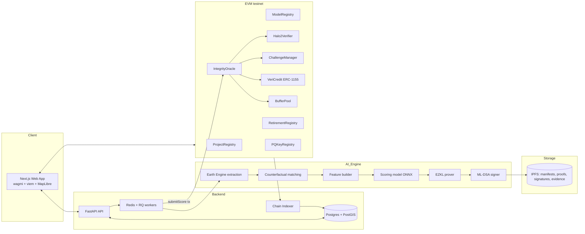
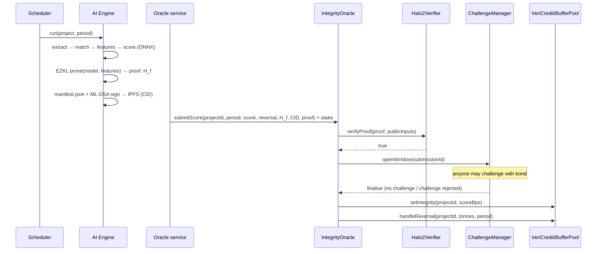

# 03 · System Architecture

## 1. Component map



## 2. Scoring lifecycle (sequence)



## 3. Trust model (state this in README)

| Component | Trust assumption (MVP) | Production path |
|---|---|---|
| Satellite data | Public datasets (ESA/USGS/UMD/NASA) accessed via Earth Engine | Multiple data providers, data-availability commitments |
| Feature extraction | Reproducible manifest; anyone can recompute; challengeable | zk/TEE proof of extraction, multiple independent oracles |
| Scoring model inference | **Cryptographically proven** (EZKL) | Same, PQ-friendly proof system later |
| Challenge resolution | 2-of-3 resolver multisig | Decentralised resolver set with staking, or full re-execution game |
| Registry admin | Multisig | DAO / standards body governance |
| Signatures | ML-DSA-65 (PQ) on manifests + ECDSA on txs | PQ account abstraction when available |

## 4. Data model (core entities)
- **Project**: id, developer, name, geometry (GeoJSON), h3Cells, h3Resolution, claimedBaseline, startDate, status.
- **Vintage**: projectId, year, issuedTonnes, bufferTonnes, tokenId.
- **ScoreSubmission**: id, projectId, period, score, reversalTonnes, featureCommitment, manifestCID, proofHash, oracle, stake, status, windowEnd.
- **Challenge**: id, submissionId, challenger, bond, reasonCode, evidenceCID, votes, outcome.
- **Retirement**: id, holder, tokenId, amount, beneficiary, scoreAtRetirement, timestamp.
- **ModelVersion**: modelHash, onnxCID, settingsCID, vkHash, verifierAddress, active.
- **PQKey**: oracle, algorithm ("ML-DSA-65"), pubKeyHash, pubKeyCID, active.

## 5. Tech stack (pin versions in lockfiles)

| Layer | Choice |
|---|---|
| Contracts | Solidity ^0.8.24, Foundry, OpenZeppelin v5 |
| Chain (testnet) | Polygon Amoy (chainId 80002) primary; Base Sepolia (84532) or Ethereum Sepolia alternative |
| Frontend | Next.js (App Router), TypeScript, Tailwind, shadcn/ui, wagmi + viem, RainbowKit, MapLibre GL (or Leaflet), h3-js, Recharts |
| Backend | Python 3.11, FastAPI, SQLAlchemy + GeoAlchemy2, Postgres 16 + PostGIS, Redis + RQ |
| AI/Geo | earthengine-api, geemap (optional), numpy, pandas, scikit-learn, PyTorch, onnx, h3-py, shapely |
| zkML | EZKL (Python bindings + CLI) |
| PQ crypto | liboqs-python (ML-DSA-65); browser verify via a WASM build or backend endpoint |
| Storage | IPFS (local kubo in dev; pinning service in prod) |
| Indexing | Custom Python indexer (web3.py) → Postgres; Ponder/The Graph optional |
| Infra | Docker Compose (dev); Vercel (web) + Railway/Render/Fly (API, workers) |
| CI | GitHub Actions: forge test, pytest, ruff, eslint, next build |

## 6. Monorepo layout

```
vericanopy/
├─ contracts/                # Foundry
│  ├─ src/
│  │  ├─ ProjectRegistry.sol
│  │  ├─ ModelRegistry.sol
│  │  ├─ IntegrityOracle.sol
│  │  ├─ ChallengeManager.sol
│  │  ├─ VeriCredit.sol
│  │  ├─ BufferPool.sol
│  │  ├─ RetirementRegistry.sol
│  │  ├─ PQKeyRegistry.sol
│  │  ├─ interfaces/
│  │  └─ verifiers/Halo2Verifier.sol   # generated by EZKL
│  ├─ test/
│  └─ script/Deploy.s.sol
├─ ai/
│  ├─ vericanopy_ai/
│  │  ├─ extract.py      # Earth Engine
│  │  ├─ matching.py     # counterfactual twins
│  │  ├─ features.py
│  │  ├─ model.py        # train + export ONNX
│  │  ├─ score.py
│  │  ├─ manifest.py
│  │  └─ h3cells.py
│  ├─ zk/
│  │  ├─ build_circuit.py
│  │  ├─ prove.py
│  │  └─ artifacts/      # settings.json, compiled circuit, vk, srs (gitignored if large)
│  ├─ pq/
│  │  ├─ keys.py
│  │  └─ sign_verify.py
│  └─ tests/
├─ backend/
│  ├─ app/ (main.py, routers/, models/, services/, workers/, indexer/)
│  └─ alembic/
├─ web/
│  ├─ app/ (map, projects/[id], register, portfolio, challenges, verify, security, demo)
│  ├─ components/
│  └─ lib/ (contracts.ts, abis/, h3.ts, api.ts)
├─ data/demo/ (geojson for Demo Projects A, B, C)
├─ docs/ (ARCHITECTURE.md, LIMITATIONS.md, BENCHMARKS.md)
├─ docker-compose.yml
└─ .github/workflows/ci.yml
```
